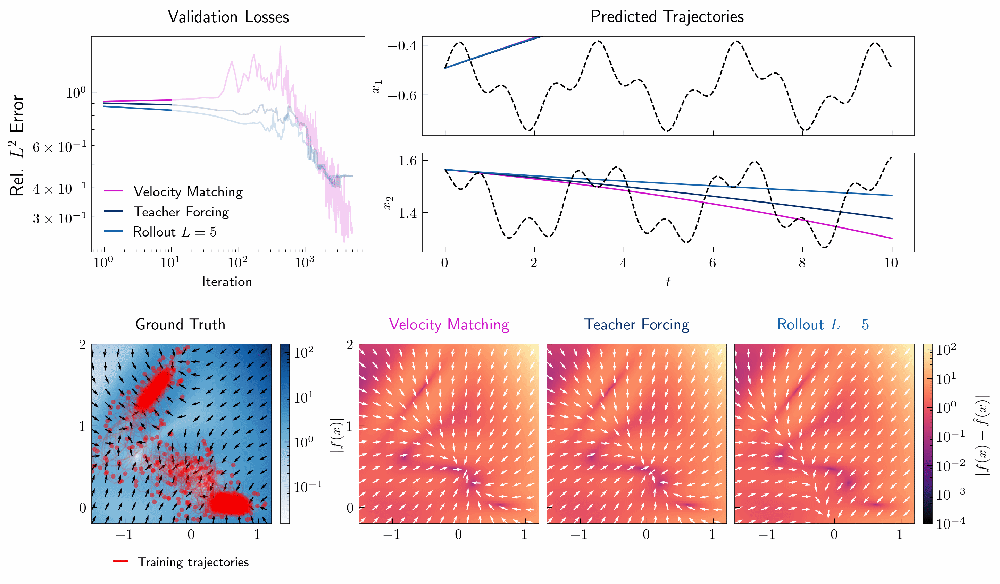

# Velocity Matching
Official repository for the paper [Learning to evolve by matching velocities](https://arxiv.org/abs/2611.00448), introducing **Velocity Matching**, a simulation-free objective for learning neural ordinary differential equations approximations of dynamical systems.

**Authors:** Nicola Farenga, Andrea Manzoni.

(Implementation coming soon)

